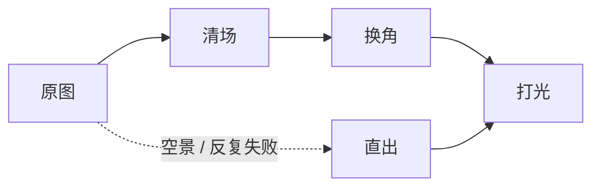

这一篇写流程，不写咒语。几十张图、两套主题，要求是**跑完一次比一次省事** —— 所以最后收敛成三步，每一步都是一次图生图调用：

1. **清场** —— 拿原图，去掉次要人物，把所有可读文字换成抽象笔触；
2. **换角** —— 拿清场结果，把主体人物换成参考图里的角色；
3. **打光** —— 拿换角结果，用固定 seed 打另一种光，得到第二个主题版本。

本文记的是这条管线怎么搭、提示词怎么写、以及踩过的九个坑 —— 其中第 3 个坑让一整批图报废。

但在这些之前还有一步：**开跑之前，先判断图里是不是已经站着你要的人。** 我第一版跳过了它，整面画墙白跑了。

> 图中角色形象：ZipZipPipe / 上善无形，社区创作、非商业展示。来源见 [AI 娘档案](../AI/AI娘档案.md)。

## 第 0 步：图里是不是已经有人物

这一步不花 GPU，却决定了后面几十次调用值不值。我第一版跳过了它，把 18 张原图一律当成「待换角」的素材，按角色优先级逐个替换 —— 跑完才发现，**其中 17 张本身就是 AI娘，多数还是设定集里的那位本人**：落日工位是鲸鱼娘，凌晨代码是大肥鱼吃白饭，月晕是拿扇子的千问，星野是紫猫耳的 Gemini。

结果很尴尬：角色换错了，图里原本的故事也一起没了。吃白饭这个梗换成别人就不好笑了；两人相拥换成一个人站着，构图还在，意思没了。

判断只需要三看：

- **看特征**：兽耳或角、发色瞳色、标志性配饰、专属道具，能不能对上设定集里的某一位。只对上一两项不算数，要能指着说「这就是她」。
- **看叙事**：这张图讲的事，是不是某个角色的专属梗。专属梗不能换人 —— 换了就不成立。
- **看归属**：多人在场的合影，往往整组都是自家人；这种图连清场都不该做。

三种结果对应三种做法：

| 判断 | 做法 |
| --- | --- |
| 已经是 AI娘 | **保留原图**，只裁切、压体积；要亮色版就程序化调色，别重画 |
| 主体不是 AI娘、故事也通用 | 才进后面的清场 + 换角 |
| 空景 | 直出，或者干脆空着 |

> 换角之前先问一句：**这张图换个角色还成立吗？** 不成立就别换。

这条判断比提示词重要得多。提示词错了只毁一张图，判断错了毁一整面墙 —— 而且每张单看都挺好看，只有排成墙才发现每张都在讲别人的故事。

## 最短路径

先把三个全局参数定死。后面九个坑里有三个都绕不开它们。

| 参数 | 取值 | 说明 |
| --- | --- | --- |
| 画布分辨率 | **1280 起** | 1024 会把高密度插画压成碎晶，见第 3 个坑 |
| 采样 | 40 步 / cfg 1.0 / euler / simple | 40 步之后收益很小；cfg 1.0 是这类模型的原生档，加引导反而僵 |
| 负向提示词 | **留空** | 负向清单会把画风一起压掉，见「提示词六条」 |

验证环境：ComfyUI 0.42.4 + Qwen-Image 2.1（int8 权重、8B 文本编码器、bf16 VAE），单卡本地推理。换显卡只会改耗时，不改结论。

## 为什么值得做成管线

> 规模：39 个槽位 × 2 个主题 = 93 个文件，压缩后 8.4 MB。后来画墙与分区封面改回原图直用（见第 0 步），真正走模型的槽位少了一半。

一张张手调的问题不是慢，而是**不可复现**：调好一张，下一张从头猜；改了一个参数，不知道哪些图得重做。

做成管线之后，每个槽位有 id、seed 和出图指纹，脚本自己就能判断「哪些图过期了」，坏一张单独重跑，不用整批陪葬。

## 三步法

### 清场：只做两件事

把次要人物拿掉，把纸张、书页、屏幕、招牌上的文字换成无法辨认的笔触与色块。别的都不要加。

> **底图必须是原始文件，不是上一版成片。** 清场要吃原图的像素；拿已经压到展示尺寸的成品当底图，等于每一步都在给上一次的损失复利 —— 这是第 3 个坑的第二层。

> **为什么**：模型不理解「结构」，只对像素分布有反应。你让它「把空出来的位置补成背景」，它就会拿纹理去填 —— 填得好不好，取决于这块空有多大、画布有多少像素。

### 换角：身份只交给参考图

参考图定身份，文字只写「发色、瞳色、服装轮廓、配饰以参考图为准，其余细节按统一画风重绘」。

**不要用文字描述角色长相。**「白发、红瞳、兽耳」这种描述，每一张都会画出不同的人；参考图才能锁住同一张脸。同一个角色在多张图里出现时，这一点是决定性的。

**但「原图要什么都别动，只换那个人」时，这条会反过来咬你。** 参考图一般是一张全身立绘，模型会顺手把它当成「这张图的主角」重新布景：人物放大一到两倍，原来的漂浮 / 扶栏 / 行走被换成正面站姿，宽银幕变成了把角色卡贴在画面上。要保住原图的动作和大小，就别喂参考图 —— 同一个编辑节点，只写文字设定，并在开头把「人物在画面中的位置与大小、以及姿势动作全部保持不变」钉死。代价是这张脸只靠文字约束，多张图之间会有出入，所以它适合「一张图一个角色」的主视觉，不适合要跨图锁脸的成套配图。

### 打光：固定 seed

暗、亮两个主题用**同一个 seed** 重打光，构图不变、只换光线。这样同一张图在深浅两套主题下是同一个画面，而不是两张碰巧相似的图。

固定 seed 的另一个好处是可复现：换一版提示词，只有光线变了，能立刻看出是提示词的问题还是运气问题。

### 例外：空景直接生成

原图是空景（没有人），或者「换角」反复失败，就别走清场 + 换角了，改成**直出**：把人物用文字写进场景描述，一次文生图，再打光。

实测「空景补人」失败了三次。原因很朴素：模型更愿意守住它已经看到的画面，不肯往里添人。让它「补一个人」和让它「从头画一个有人物的场景」，难度差一个量级 —— 后者反而更稳。

## 提示词六条

1. **不写负向提示词。** 负向清单里往往塞着「低质量、多手指、水印」这类词，它们会把画风一起压平。Qwen 系的负向档留空即可，画面问题用正向描述去框。
2. **不写质量词。** `masterpiece`、`best quality`、`8k` 这些既不会被理解成质量，也不会让图变好，只会占位置。
3. **保留写薄，改动写足。** 要保留的东西一句话带过（「构图、机位、景别、景深保持一致」）；要改的东西写具体（换谁、换成什么、哪些属性以参考图为准）。
4. **身份只交给参考图。** 见上一节。
5. **文字一律抽象化。** 只要提示词里允许画面「有字」，模型就会造出一堆似是而非的汉字。直接规定「所有文字替换为无法辨认的笔触」，比事后修图省事得多。
6. **结构用固定句式锚定。** 构图、镜头角度、景别、人物位置、动作、景深，用同一句话钉住，重跑时才不会漂。

## 九个坑

### 1. 空景补人，补了三次都没人

- **现象**：清场后的空房间，让它「补一个人站在窗边」，出来还是空的。
- **根因**：模型倾向于保持已有画面，对「新增实体」的服从度远低于「替换实体」。
- **改法**：改直出。人物写进场景描述，一次文生图。三个空景槽位里有两个这样救回来。

### 2. 文生图一开跑就漂成水彩

- **现象**：同一条管线，图生图出来是干净的赛璐璐，纯文生图出来是厚涂水彩。
- **根因**：生图模板里漏了「画风中位句」，模型只能从内容里自己猜风格。
- **改法**：把画风描述（「干净的线稿、柔和的赛璐璐上色」）拼进模板第一句，而不是指望参考图。

### 3. 分辨率不够，整批图变成碎晶 ★

这是最贵的一个坑：整面画墙 18 张，全部炸成马赛克。查下来是两层原因叠在一起。

**第一层：画布不够。**

- **现象**：细节区域碎成玻璃状纹理，人物有时还在、有时干脆没换成功。
- **测量**：用边缘响应均值（下称「边缘能」）粗看细节密度。同一批图，源图 10.0 → 成图 14.1（×1.42），个别单张到 ×3.7。也就是说模型不是在修图，是在**凭空造高频纹理**。
- **对照**：同时期生成的另一批分区封面，边缘能是 7.9 → 2.8（×0.35），越画越平、越画越干净。

为什么同一套提示词，一批在造噪声、一批在抹细节？做了三组对照实验，每次只改一个变量：

| 实验 | 结果 | 排除 |
| --- | --- | --- |
| 给画墙槽位补一句光照描述 | 边缘能 12.2 → 12.5 | 提示词**不是**主因 |
| 给分区槽位套画墙的分辨率（1024） | 依然干净 | 1024 **单独**不致死 |
| 给画墙槽位套分区的分辨率（**1280**） | 4/4 复原，角色也换对了；扩到全批 18/18 | 定位成功 |

- **根因**：画墙槽位的源图只有 880×550，却把出图画布设成 1024（约 1.0 MP）；分区是 1200×750 配 1280（约 1.6 MP）。**少了 60% 的像素预算。** 1 MP 对高密度插画（樱花、灯笼、花瓣、食物、书脊）不够塞，高频挤在一起就碎；分区源图是平滑的 3D 渲染加大面积平涂，1 MP 也吃得下 —— 所以「便宜的那批反而好看」。
- **改法**：画布分辨率按内容密度定，源图不足 1 MP 的一律 1280 起。代价是换角从约 60 秒涨到约 100 秒。

**第二层：底图不是原图。**

把分辨率改上去重跑，才看到更根本的一处：清场槽位的底图路径填的是**上一版成片**（`docs/public/art/...`，已经是压到 880×550 的 WebP），而不是素材库里的原始文件。等于拿一张压缩过的小图去清场，再拿清场结果去换角 —— 每一环都在给上一环的损失复利，画布给到 1280 也只是把一张将就的底子放大。

- **改法**：源图、中间图、成片各占一个目录，成片不再回流当输入。底图一律指回原始 PNG（这批是 1500×900 上下），按展示比例 1.6 预裁一次再交给清场。
- **结果**：18 张全部复原，边缘能回到源图水平（源 17.2 → 成图 17.8，×1.03），不再是 ×1.42 的造噪声。
- **教训**：批量出图最贵的错误是**参数在两组之间不一致**，其次是**产物回流当输入**。同一批图要么统一参数，要么把参数差异写进日志。
- **后续**：画墙最后没有采用这批生成图 —— 源图本身就有角色，按第 0 步的规则保留原图了。但上面两条结论对还在走管线的分区封面一样成立。

### 4. 换角失败和碎晶是同一个病

同一张图，1024 出来的还是原来的粉发少女，1280 才换成目标角色。

分辨率不够时，模型连「把这个人换成另一个人」都做不到 —— 它没有足够的像素去重建五官，最省事的做法就是保留原来的。所以看到「角色没换成功」，先别改提示词，先看分辨率。

### 5. 多人场景，抹掉人之后补不回来

合影里有四到六个人，清场要求「只保留一位，其余移除，空位由背景补足」。结果背景是补上了，但补成了花海、补成了碎花 —— 桌子、餐具、道具一起消失。

- **根因**：要补的面积太大，模型没有依据，只能自由发挥。
- **改法**：多人场景别硬抹。要么换一张单人构图的原图，要么走直出重新生成画面。管线再好，也救不了「要抹掉画面七成内容」的需求。
- **前提**：抹之前先做第 0 步的判断。合影里的人如果本来就是设定集里的角色，这张图根本不需要动 —— 抹了再补，只会把构图也补丢。

还有一种更轻的补救：**只给这一个槽位补一句描述**。水墨群像那张清场后只剩一张白纸，换角时补一句「留白处以淡墨勾勒数位无名身影，只留轮廓、不画五官」，群像的意味就回来了。这类补充要按槽位存（本人实现成槽位上的 `prompt_extra`，只拼在换角/填空那一步），别改全局模板 —— 全局一改，别的槽位跟着变。

### 6. 压缩：质量下限要下得去

1600×900 的高密度图，WebP 质量 80 有 400 KB，压到质量 54 仍超 250 KB 的自定上限。

- **改法**：把编码器的质量下限放到 36，让「单张体积上限」来定质量，而不是拍一个固定质量值。44～84 的实际质量区间，肉眼在全宽展示时几乎看不出差别。
- **配套**：总量也要设闸门（例如全站 12 MB），否则一张张「都还行」加起来就爆了。

### 7. 哈希不含分辨率，配置改了却不出图

脚本用「提示词哈希」判断一张图是否过期。提示词没改、只改了分辨率或 seed 时，哈希不变，脚本认为「已完成」直接跳过 —— 配置改了，图还是旧的，而且不报错。

- **改法**：把「提示词哈希」升级成「出图指纹」—— 提示词、分辨率、seed、直出画布一起进哈希。旧日志里只有提示词哈希的条目，用它当时记下的分辨率与 seed 补判，所以升级不会把已经出好的图全判成过期。
- **教训**：可复现性不是「存了 prompt」就够了，得让**所有输入**都参与指纹。

### 8. 换角换成了「贴纸」★

- **现象**：三张宽银幕主视觉，原本是远处一个小小的身影（漂在深海里 / 站在船头 / 走在山脊上）。换角之后同一个人被放大到占满画面高度，正面站定，背景还在但构图散了 —— 像把一张角色卡贴在风景照中间。
- **根因**：参考图是全身立绘，它自带的取景（一个人占满画幅）比画布更有话语权。模型同时看到「一张构图很松的宽画布」和「一张构图很紧的立绘」时，会按立绘重新布景，而不是按画布。
- **改法**：这类槽位改成**不带参考图的编辑** —— 原图当画布，角色设定写成文字，提示词第一句就钉住「构图、镜头、人物位置与大小、姿势动作全部不变」「不要拉近镜头、不要放大人物、不要重新构图」。
- **验证方式**：把原图和成图按同宽上下叠着看。人物的相对高度、头顶留白、脚下落点这三样只要有一样变了，就是被重新布景了。

### 9. 手上有了一张好图，但它和场景是两张画 ★

- **现象**：角色人设、动作、构图都对，就是「贴上去的」——人物比周围亮一档、边缘发硬、身上没有环境里的雾和光，而且个头比同组其他图大一倍。
- **根因**：不是调色的问题，是**空间关系**没建立：她没被环境光照到，也没有任何东西挡在她前面（雾、颗粒、光柱），边缘还留着原背景的描边。
- **改法**：先抹人，再贴人，最后重画一遍。
  1. 用一次编辑把人物整块去掉，得到一张干净的背景板（同一场景、同一光位、同一批水母 —— 只是没有人）；
  2. 从原图里抠出人物（GrabCut 给个矩形就够，再用距离变换把边缘削掉 1～3 px，去掉残留的暗边）；
  3. 缩到「画面高度的四成左右」贴回板上，按高度做雾（越靠下越浑，颜色取背景板局部均值），再借环境亮度镀一圈轮廓光，前景撒几个虚焦颗粒；
  4. 最后交给模型**按原样重绘一次**（构图、位置、光照、色彩都写死不许动）：这一遍把人被放大时的软边、拼缝和板子之间的清晰度差一起抹平，人物才真的坐进水里。
- **代价**：人物会掉一档细节（她本来就是从一张小图里抠出来的），所以第 4 步的重绘不是可选项。
- **验证方式**：只看轮廓。如果闭眼再睁眼，第一眼注意到的是她的脸而不是她的边，就算过关；反之就是边缘还在「切」画面。

## 验收：一分钟判断一批图能不能用

单看一张会骗人 —— 单独放一张觉得还行，排成一面墙才发现每张都不一样。两个办法：

1. **联排**：按最终展示尺寸拼成 5～6 列的大表，同屏比较。身份漂移、色调不统一、纹理炸裂，都是在这个尺寸下才现形的。
2. **边缘能**：源图与成图各算一次细节密度，看倍数。**大幅上涨 = 模型在编细节；大幅下降 = 在抹细节。** 前者对高密度插画基本等于翻车，后者通常意味着画面在变干净。

指标只用来发现异常，不用来替代眼睛 —— 最后还是要看联排。

## 成本

单卡本地推理，实际耗时（含排队）：

| 步骤 | 1.0 MP（1024） | 1.6 MP（1280） |
| --- | --- | --- |
| 清场 | 约 35 秒 | 约 65 秒 |
| 换角 | 约 60 秒 | 约 100 秒 |
| 打光 | — | 约 65 秒 |
| 直出（文生图） | — | 约 60 秒 |

耗时几乎全花在画布像素上，翻倍的分辨率大约翻倍的等待。39 个槽位全量重跑约 2 小时。所以参数要在第一批就定对 —— 第 3 个坑的返工成本正好是一整批。

## 边界

这套管线适合「一张图一个主体人物、构图不掉」的场景，比如站点配图、封面、角色立绘。

不适合：

- **写实照片风格** —— 换角会把质感一起换掉；
- **需要精确文字** —— 模型只会画似是而非的字，无法指定内容；
- **多人互动构图** —— 见第 5 个坑，抹人和补背景都不稳定。

以及一条底线：用别人画的角色做参考图时，署名和许可要说清楚，见 [AI 娘档案](../AI/AI娘档案.md)。
